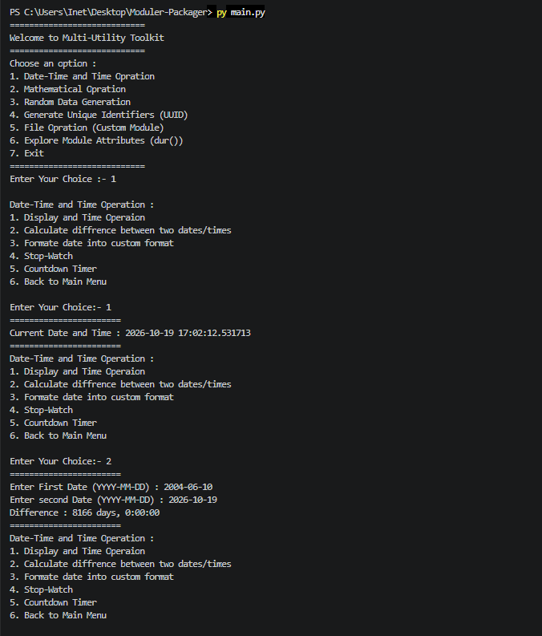

# Multi-Utility Toolkit

A simple Python-based console application that provides multiple useful utilities in one program, including date-time operations, mathematical calculations, random data generation, UUID generation, file operations, and module exploration.

---

## 📌 Description

**Multi-Utility Toolkit** is a menu-driven Python project designed for beginners.  
It uses Python modules and packages to perform different tasks such as:

- Displaying current date and time
- Calculating difference between two dates
- Creating a stopwatch and countdown timer
- Performing mathematical calculations
- Generating random numbers, passwords, and OTPs
- Creating and managing text files
- Exploring Python module attributes using `dir()`

The project is divided into multiple custom modules and organized using a Python package structure.

---

## ✨ Features

### 1. Date-Time and Time Operations
- Display current date and time
- Calculate difference between two dates
- Format date and time
- Stopwatch
- Countdown timer

### 2. Mathematical Operations
- Calculate factorial
- Calculate compound interest
- Trigonometric calculations
- Calculate area of circle, rectangle, and square

### 3. Random Data Generation
- Generate random numbers
- Generate random list
- Create random password
- Generate random OTP

### 4. Unique Identifier Generator
- Generate UUID using Python’s `uuid` module

### 5. File Operations
- Create a new file
- Write data to a file
- Read data from a file
- Append data to a file

### 6. Explore Module Attributes
- Explore attributes of Python modules:
  - `math`
  - `uuid`
  - `random`
  - `time`
  - `datetime`
  - `string`

---

## 🛠️ Technologies Used

- Python 3
- Python Standard Library
- `math` module
- `random` module
- `uuid` module
- `time` module
- `datetime` module
- `string` module
- File handling (`open()`, `read()`, `write()`, `append()`)
- Python packages and modules

---

## 📥 Install Python

1. Go to the official Python website:  
   https://www.python.org/downloads/

2. Download the latest Python version.

3. During installation, select:

```text
Add Python to PATH
```

4. After installation, check Python version:

```bash
python --version
```

or

```bash
python3 --version
```

---

## ▶️ How to Run

1. Open Command Prompt or PowerShell.

2. Go to the project folder:

```bash
cd "C:\Users\Mr-A\OneDrive\Desktop\moduer and pacakage"
```

3. Run the program:

```bash
python main.py
```

Example:

```bash
python "c:/Users/Mr-A/OneDrive/Desktop/moduer and pacakage/main.py"
```

---

## 📁 Program Structure

```text
 
├── package
│  ├── __init__.py
│  ├── exlpore_utils_module.py
│  ├── file_utils_moduls.py
│  └── math_utils_module.py
│
├── README.md
├── main.py
└── output.png
 
```
 
 
## 📷 Screenshot

---

## 👨‍💻 Author

KETAN KUMAR